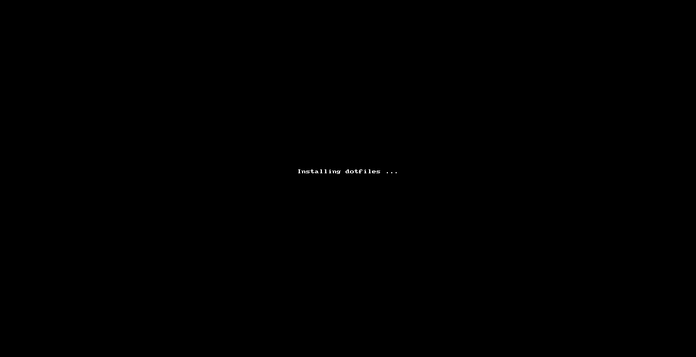

# Carlos Chacin's Dotfiles

Personal dotfiles for macOS and Unix environments, featuring autonomous bootstrap, GNU Stow symlink orchestration, Mise runtime management, and AI coding agent integration (Herdr + Pi).



---

## Quick Start (Bootstrap a New Machine)

Run the autonomous bootstrap script:

```sh
sh -c "$(curl -fsSL https://raw.githubusercontent.com/cchacin/dotfiles/main/install.sh)"
```

Or clone and run locally:

```sh
git clone https://github.com/cchacin/dotfiles.git ~/dotfiles
cd ~/dotfiles
./install.sh
```

### What `install.sh` Does:
1. **Installs Base Primitives**: Automatically installs Homebrew (macOS) and Mise if missing.
2. **Runs Homebrew Bundle**: Restores macOS GUI casks and base formulas from `brew/Brewfile`.
3. **Collision-Safe Symlinking**: Backs up any conflicting regular files into `~/.dotfiles.backup.<timestamp>/` and links Stow packages using [GNU Stow][1].
4. **Installs Runtimes & CLIs**: Runs `mise install` for all developer tools and programming languages.
5. **Configures AI Agent Environment**: Runs `mise run setup:agent` to provision Pi default settings, install the Herdr integration extension, and generate Agent Skills.
6. **Configures Shell**: Verifies and sets Zsh as the default login shell.

---

## Architectural Principles & Seams

- **Package Seam**:
  - **Homebrew** (`brew/Brewfile`): Manages macOS Base Primitives (`stow`, `git`, `mise`) and macOS GUI Casks (Ghostty, 1Password, Slack, etc.).
  - **Mise** (`mise/.config/mise/config.toml`): Exclusively manages all programming languages (Java, Node, Python, Go, Ruby, Rust), CLI utilities, and developer tools.
- **GNU Stow Symlinks**: Each top-level folder (e.g. `zsh/`, `git/`, `mise/`, `herdr/`) is an isolated Stow package whose contents mirror `$HOME`.
- **Machine Overrides (`*.local`)**: Machine-specific tokens, work emails, and custom environment variables belong in uncommitted local files (`~/.gitconfig.local`, `~/.zshrc.local`).
- **AI Agent Integration**: Agent skills and runtime bridges are managed dynamically in `~/.agents/skills/` without checking volatile vendor artifacts into git.

---

## Tools & Ecosystem

### Shell & Terminal
- **Zsh**: Managed with [Antidote][3] (Zsh plugin manager) and styled with [Powerlevel10k][4].
- **Terminal**: [Ghostty][7] configured via `ghostty/`.
- **Multiplexer & Workspaces**: [Herdr][8] terminal multiplexer for managing agent sessions, tabs, and split panes.

### AI Coding Agents & Skills
- **Pi**: Coding agent harness configured with Google Gemini models.
- **Herdr Integration**: Live agent detection and pane coordination via `herdr integration install pi`.
- **Engineering Skills**: 38+ composable engineering skills from [mattpocock/skills][9] installed under `~/.agents/skills/`.
  - Update all agent skills anytime with: `mise run skills:update`

### Git & Diffing
- Global Git config with histogram diff algorithm.
- Delta and [Hunk][10] diff visualizer integration.
- Custom work identity support via `~/.gitconfig.local` or `[includeIf "gitdir:~/workplace/"]`.

---

## Managing Changes

- **Update Dotfiles**: `git pull && ./install.sh`
- **Regenerate Brewfile**: `brew bundle dump -f --file=brew/Brewfile`
- **Re-link a Specific Package**: `stow -R <package_name>`
- **Update Skills & Agent Setup**: `mise run setup:agent`

[1]: https://www.gnu.org/software/stow/manual/stow.html
[2]: https://ohmyz.sh/
[3]: https://getantidote.github.io/
[4]: https://github.com/romkatv/powerlevel10k
[5]: https://brew.sh/
[6]: https://mise.jdx.dev/
[7]: https://ghostty.org/
[8]: https://herdr.dev/
[9]: https://github.com/mattpocock/skills
[10]: https://github.com/cchacin/dotfiles/tree/main/hunk
